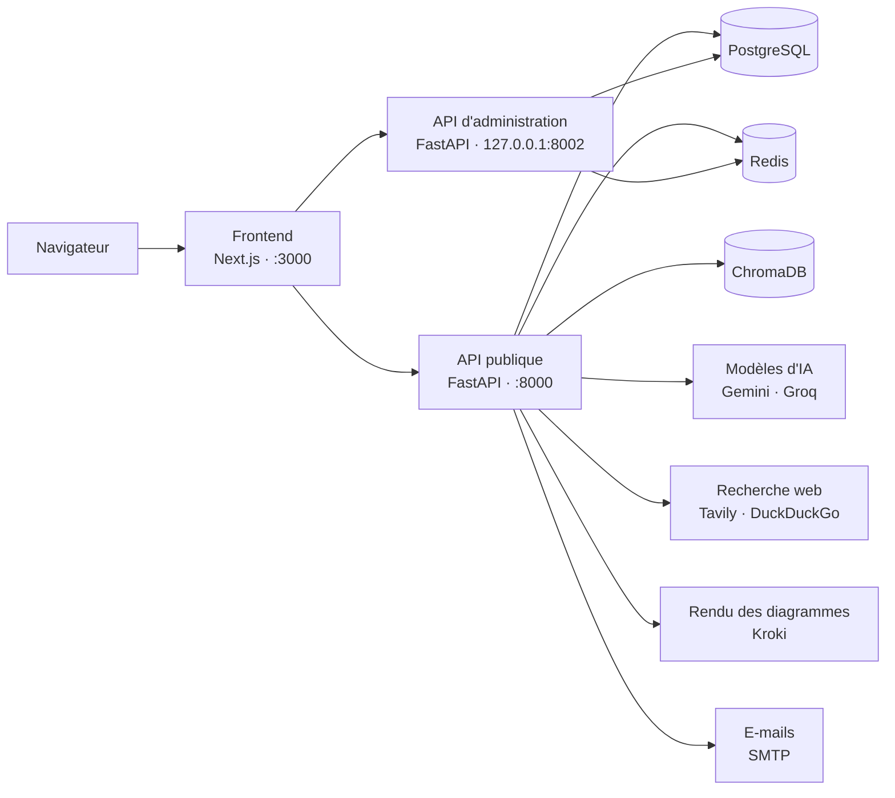

# ForgeAI

**Plateforme d'aide à la décision qui transforme une idée de projet ou de startup en dossier
d'étude complet, argumenté et exportable.**

ForgeAI produit, à partir d'une description libre, une étude de marché, une analyse de la
concurrence, un SWOT, un Business Model Canvas, une estimation financière, des personas, une
vérification des faits, un score et un verdict, puis un plan produit (backlog, sprints) et une
architecture technique (stack, base de données, diagrammes UML). L'ensemble est exportable en
PDF, Word et PowerPoint.

Le système repose sur un principe de séparation des responsabilités : **les agents d'IA
proposent, des règles déterministes valident et décident, l'interface affiche.** Une analyse ne
démarre que lorsque le contexte du projet est suffisamment précis ; à défaut, la plateforme
soumet d'abord des questions de clarification.

---

## Sommaire

1. [Fonctionnalités](#1-fonctionnalités)
2. [Architecture](#2-architecture)
3. [Démarrage rapide](#3-démarrage-rapide)
4. [Prérequis](#4-prérequis)
5. [Récupération du code](#5-récupération-du-code)
6. [Configuration des services externes](#6-configuration-des-services-externes)
7. [Installation détaillée](#7-installation-détaillée)
8. [Espace utilisateur](#8-espace-utilisateur)
9. [Console d'administration](#9-console-dadministration)
10. [Exploitation](#10-exploitation)
11. [Tests](#11-tests)
12. [Dépannage](#12-dépannage)
13. [Sécurité](#13-sécurité)

---

## 1. Fonctionnalités

### Espace utilisateur

| Domaine | Fonctionnalités |
|---|---|
| Compte | Inscription par e-mail ou via Google, vérification de l'adresse, réinitialisation du mot de passe |
| Projets | Création, modification, langue du rapport (français ou anglais) |
| Contexte | Contrôle de maturité de l'idée, questions de clarification ciblées |
| Analyse | Marché, concurrence, SWOT, Business Model Canvas, finances, personas, vérification des faits, score, verdict, débat contradictoire |
| Plan produit | Backlog priorisé, estimation en points, planification des sprints, métriques |
| Architecture | Style d'architecture, stack technique, schéma de base de données, diagrammes UML (cas d'usage, classes, séquence, activité) |
| Exports | Rapport PDF, document Word, pitch deck PowerPoint |

### Console d'administration

| Page | Rôle |
|---|---|
| Tableau de bord | Indicateurs clés de la plateforme |
| Utilisateurs | Recherche, filtres, rôles, activation, renvoi de l'e-mail de vérification, création d'administrateurs, export CSV |
| Projets | Consultation, recherche, suppression, export CSV |
| Analyses IA | Suivi, relance, diagnostic détaillé par étape (sources, preuves, erreurs, données brutes) |
| Erreurs | Analyses en échec |
| Santé du système | Test effectif de chaque service et de chaque modèle d'IA configuré |
| Journal d'audit | Traçabilité des connexions et actions d'administration, export CSV |

---

## 2. Architecture



| Composant | Technologie | Rôle | Adresse locale |
|---|---|---|---|
| `frontend` | Next.js, React, TypeScript | Espace utilisateur et console d'administration | http://localhost:3000 |
| `backend` | FastAPI (Python 3.11) | API publique, exécution des analyses | http://localhost:8000 (documentation : `/docs`) |
| `backend-admin` | FastAPI | API d'administration, isolée de l'API publique | http://127.0.0.1:8002 |
| `postgres` | PostgreSQL 16 | Données applicatives et journal d'audit | port 5432 |
| `redis` | Redis 7 | Limitation des tentatives de connexion, cache | port 6379 |
| `chromadb` | ChromaDB 0.5.5 | Base vectorielle | port 8001 |

Les services backend, base de données, cache et base vectorielle sont orchestrés par Docker
Compose. Le frontend est exécuté séparément avec npm. Les demandes de relance d'analyse émises
par la console sont placées dans une file en base de données, puis exécutées par l'API publique.

---

## 3. Démarrage rapide

Procédure résumée pour un poste disposant déjà des prérequis (section 4) et des clés d'API
(section 6).

```
git clone https://github.com/Abd-Elmouhib-Souri/ForgeAI.git
cd ForgeAI
python scripts/init_env.py                 # crée .env et génère les secrets internes
# renseigner GEMINI_API_KEY et/ou GROQ_API_KEY dans .env
docker compose up -d --build
docker compose exec backend alembic upgrade head
docker compose exec backend python -m app.scripts.create_admin
cd frontend
npm ci
npm run dev
```

| Accès | Adresse |
|---|---|
| Espace utilisateur | http://localhost:3000 |
| Console d'administration | http://localhost:3000/admin/login |
| Documentation de l'API publique | http://localhost:8000/docs |

---

## 4. Prérequis

| Outil | Version minimale | Téléchargement | Vérification |
|---|---|---|---|
| Git | récente | https://git-scm.com/downloads | `git --version` |
| Docker Desktop (Docker Compose v2) | récente | https://www.docker.com/products/docker-desktop/ | `docker compose version` |
| Node.js | 20.9 | https://nodejs.org/ | `node --version` |
| Python | 3.10 | https://www.python.org/downloads/ | `python --version` |

- **Espace disque** : environ 10 Go (images Docker et dépendances).
- **Windows** : Docker Desktop s'appuie sur WSL 2, installé au premier lancement. Docker Desktop
  doit être démarré avant toute commande `docker`.
- **Python** n'est requis que pour le script de configuration (`scripts/init_env.py`), qui
  n'utilise que la bibliothèque standard.

---

## 5. Récupération du code

Le dépôt est privé : l'accès nécessite une invitation du propriétaire.

1. Disposer d'un compte GitHub (https://github.com/signup).
2. Communiquer l'identifiant GitHub au propriétaire du dépôt, qui envoie l'invitation
   (Settings → Collaborators → Add people).
3. Accepter l'invitation reçue par e-mail ou depuis https://github.com/notifications.
4. Cloner la branche `main` :

```
git clone https://github.com/Abd-Elmouhib-Souri/ForgeAI.git
cd ForgeAI
```

> [!NOTE]
> Lors du premier accès, Git ouvre une authentification GitHub dans le navigateur. En ligne de
> commande, l'authentification s'effectue avec un jeton d'accès personnel
> (https://github.com/settings/tokens), et non avec le mot de passe du compte.

> [!TIP]
> Un chemin d'installation sans espaces ni caractères accentués (par exemple `C:\projets\ForgeAI`)
> évite les incompatibilités de certains outils.

---

## 6. Configuration des services externes

ForgeAI s'appuie sur des services tiers disposant d'offres gratuites adaptées à l'évaluation.
Chaque installation utilise ses propres clés.

| Variable (`.env`) | Service | Statut | Usage |
|---|---|---|---|
| `GEMINI_API_KEY` | Google Gemini | Requise (au moins un fournisseur d'IA) | Agents d'IA de l'analyse |
| `GROQ_API_KEY` | Groq | Requise (au moins un fournisseur d'IA) | Agents d'IA, relais automatique de Gemini |
| `TAVILY_API_KEY` | Tavily | Recommandée | Recherche web des sources |
| `GEMINI_SEARCH_CLASSIFIER_API_KEY` | Google Gemini | Optionnelle | Classement des sources par Gemini |
| `GOOGLE_CLIENT_ID`, `GOOGLE_CLIENT_SECRET` | Google Cloud (OAuth 2.0) | Optionnelles | Connexion « Continuer avec Google » |
| `SMTP_USERNAME`, `SMTP_PASSWORD`, `SMTP_FROM_EMAIL` | Gmail ou autre serveur SMTP | Optionnelles | Envoi des e-mails transactionnels |
| `KROKI_ENABLED`, `KROKI_BASE_URL` | Kroki | Préconfigurées, sans clé | Rendu des diagrammes UML |

La configuration des deux fournisseurs d'IA est recommandée : en cas de quota atteint ou
d'indisponibilité de l'un, l'autre est utilisé automatiquement. Les secrets internes (signature
des jetons, session, chiffrement des secrets 2FA, mot de passe PostgreSQL, jeton ChromaDB) sont
générés par `scripts/init_env.py` et ne nécessitent aucune action.

### 6.1 Google Gemini

1. Ouvrir https://aistudio.google.com/apikey et se connecter avec un compte Google.
2. Accepter les conditions d'utilisation de Google AI Studio si elles sont présentées.
3. Sélectionner **Create API key**, puis choisir ou créer un projet Google Cloud.
4. Reporter la clé obtenue (préfixe `AIza`) dans `.env` : `GEMINI_API_KEY=...`
5. Optionnel : reporter la même clé dans `GEMINI_SEARCH_CLASSIFIER_API_KEY` pour activer le
   classement des sources par Gemini.

### 6.2 Groq

1. Créer un compte sur https://console.groq.com.
2. Ouvrir la page **API Keys** (https://console.groq.com/keys) et sélectionner **Create API Key**.
3. Copier la clé à l'affichage (préfixe `gsk_`) : elle n'est plus consultable ensuite.
4. Reporter la clé dans `.env` : `GROQ_API_KEY=...`

### 6.3 Tavily

1. Créer un compte sur https://app.tavily.com.
2. Copier la clé affichée dans la section **API Keys** du tableau de bord (préfixe `tvly-`).
3. Reporter la clé dans `.env` : `TAVILY_API_KEY=...`

En l'absence de clé Tavily, la recherche web bascule automatiquement sur DuckDuckGo, avec un
nombre de sources généralement inférieur.

### 6.4 Connexion avec Google (optionnelle)

1. Créer un projet sur https://console.cloud.google.com.
2. Configurer l'écran de consentement OAuth
   (https://console.cloud.google.com/apis/credentials/consent) :
   type **Externe**, nom de l'application `ForgeAI`, adresse de support, et liste des
   **utilisateurs de test** autorisés tant que l'application est en mode test.
3. Créer un identifiant **ID client OAuth** de type **Application Web**
   (https://console.cloud.google.com/apis/credentials) :

   | Paramètre | Valeur |
   |---|---|
   | Origines JavaScript autorisées | `http://localhost:3000` |
   | URI de redirection autorisés | `http://localhost:8000/auth/google/callback` |

4. Reporter l'ID client et le code secret (préfixe `GOCSPX-`) dans `GOOGLE_CLIENT_ID` et
   `GOOGLE_CLIENT_SECRET`.

L'URI de redirection doit correspondre exactement à la valeur de `GOOGLE_REDIRECT_URI` dans `.env`.

### 6.5 Envoi des e-mails (optionnel)

Configuration avec Gmail :

1. Activer la validation en deux étapes du compte Google
   (https://myaccount.google.com/signinoptions/twosv).
2. Générer un mot de passe d'application (https://myaccount.google.com/apppasswords), nommé
   par exemple `ForgeAI`. Le mot de passe de 16 caractères n'est affiché qu'une seule fois.
3. Renseigner `.env` :

   ```
   SMTP_USERNAME=adresse@gmail.com
   SMTP_FROM_EMAIL=adresse@gmail.com
   SMTP_PASSWORD=<mot de passe d'application, sans espaces>
   ```

Pour un autre fournisseur (Brevo, Mailgun, Outlook…), les variables `SMTP_HOST` et `SMTP_PORT`
sont à adapter selon sa documentation.

> [!NOTE]
> Sans configuration SMTP et en environnement de développement (`ENVIRONMENT=development`), le
> contenu des e-mails, liens compris, est écrit dans le journal du backend (section 8.2). Ce mode
> de secours est désactivé en production.

> [!IMPORTANT]
> Le mot de passe d'application est distinct du mot de passe du compte Google, qui ne doit
> jamais figurer dans `.env`.

### 6.6 Rendu des diagrammes : Kroki (aucune clé)

ForgeAI génère le code PlantUML des diagrammes de l'architecture, puis en délègue le rendu à un
serveur **Kroki** : SVG pour l'interface, PNG pour les exports. Kroki est un logiciel libre ; il ne
requiert ni compte ni clé d'API, uniquement l'adresse d'un serveur :

```
KROKI_ENABLED=true
KROKI_BASE_URL=https://kroki.io
```

| `KROKI_BASE_URL` | Serveur | Contexte d'utilisation |
|---|---|---|
| `https://kroki.io` (par défaut) | Service public | Accès Internet sans restriction vers kroki.io |
| `http://host.docker.internal:8010` | Conteneur local | Réseau filtré (VPN, réseau d'entreprise), usage hors connexion, confidentialité des diagrammes |

Déploiement du conteneur local (opération unique) :

```
docker run -d --name kroki-local --restart unless-stopped -p 8010:8000 yuzutech/kroki
```

Renseigner ensuite `KROKI_BASE_URL=http://host.docker.internal:8010` dans `.env`, puis recharger
le backend (section 10.2). L'adresse `host.docker.internal` désigne le poste hôte depuis les
conteneurs sous Docker Desktop (Windows, macOS) ; sous Linux, ajouter
`extra_hosts: ["host.docker.internal:host-gateway"]` au service `backend`.

Contrôle de la connectivité depuis le backend :

```
docker compose exec backend python -c "import os, httpx; u = os.getenv('KROKI_BASE_URL'); print(os.getenv('KROKI_ENABLED'), u, httpx.get(u + '/health', timeout=10).status_code)"
```

Résultat attendu : `true <adresse> 200`.

> [!NOTE]
> Lorsque Kroki n'est pas joignable, l'architecture et le code PlantUML restent disponibles :
> l'interface affiche « Rendu visuel indisponible » accompagné du code source, et les exports
> remplacent chaque image par la mention « diagramme indisponible ». L'action
> « Régénérer l'architecture » produit les images une fois Kroki accessible.

### 6.7 Limites des offres gratuites

Une analyse complète enchaîne de nombreux appels aux modèles d'IA. Les offres gratuites
permettent l'évaluation de la plateforme, avec les limites suivantes :

| Fournisseur | Limite constatée | Effet |
|---|---|---|
| Gemini (offre gratuite) | Environ 20 requêtes par jour et par modèle récent | Environ une analyse complète par jour ; message « Quota exceeded… FreeTier » au-delà |
| Groq (offre gratuite) | Plafond de jetons par minute | Refus des requêtes volumineuses (« Request too large »), notamment pour le plan produit |

Comportement de la plateforme face à ces limites :

- bascule automatique entre Gemini et Groq lorsque les deux clés sont configurées ;
- en l'absence de modèle disponible, le plan produit est construit par des règles déterministes
  (statut « Provisoire »), puis régénéré automatiquement par l'IA (jusqu'à six tentatives) ;
- `GEMINI_FALLBACK_MODEL` est laissé vide par défaut : certains modèles ne sont plus ouverts aux
  nouveaux comptes (« no longer available to new users »). La page **Santé du système** contrôle
  l'existence de chaque modèle configuré.

Un usage régulier (démonstrations, analyses multiples) nécessite l'activation de la facturation
dans la rubrique « Billing » de Google AI Studio (https://aistudio.google.com) et de la console
Groq (https://console.groq.com).

---

## 7. Installation détaillée

Les commandes s'exécutent depuis la racine du dépôt et sont identiques sous Windows
(PowerShell), macOS et Linux.

### 7.1 Configuration

```
python scripts/init_env.py
```

Le script génère, à partir des modèles versionnés :

| Fichier | Contenu |
|---|---|
| `.env` | Configuration du backend, de l'API d'administration, de PostgreSQL et de ChromaDB ; secrets internes générés aléatoirement |
| `frontend/.env.local` | Adresses de l'API publique et de l'API d'administration |

Le script liste ensuite les clés d'API restant à renseigner (section 6). Il ne remplace jamais
un fichier existant ; une régénération complète nécessite la suppression préalable de `.env` et
de `frontend/.env.local`.

> [!TIP]
> Le fichier `.env` généré commence par la ligne `# ForgeAI : modèle de configuration`, ce qui
> permet de s'assurer que le bon fichier est modifié.

### 7.2 Démarrage des services

```
docker compose up -d --build
docker compose ps
```

La première exécution télécharge les images et installe les dépendances Python (5 à 15 minutes
selon la connexion). `docker compose ps` doit présenter cinq services à l'état `Up`, dont
PostgreSQL à l'état `healthy`.

### 7.3 Schéma de la base de données

```
docker compose exec backend alembic upgrade head
docker compose exec backend alembic current
```

La seconde commande doit afficher une révision suivie de `(head)`. Cette étape est à répéter
après chaque mise à jour du code (section 10.3).

### 7.4 Premier administrateur

```
docker compose exec backend python -m app.scripts.create_admin
```

La commande demande l'adresse e-mail, le nom complet et le mot de passe de l'administrateur
(12 caractères minimum, saisie masquée et confirmée). Le compte est créé avec une adresse
vérifiée ; si l'adresse correspond à un compte existant, ce compte reçoit le rôle
d'administrateur. L'opération est inscrite au journal d'audit.

Variante non interactive, notamment lorsque le terminal ne prend pas en charge la saisie masquée :

```
docker compose exec -e FORGEAI_ADMIN_PASSWORD="<mot de passe>" backend python -m app.scripts.create_admin --email admin@exemple.com --name "Prénom Nom"
```

> [!WARNING]
> La variante non interactive conserve le mot de passe dans l'historique du terminal
> (effacement sous PowerShell : `Clear-History`).

### 7.5 Frontend

Dans un terminal dédié, maintenu ouvert pendant l'utilisation :

```
cd frontend
npm ci
npm run dev
```

L'application est disponible lorsque le terminal affiche `Ready` et l'adresse http://localhost:3000.

### 7.6 Vérification

La page **Santé du système** de la console (section 9) contacte chaque service et indique son état :

| État | Signification |
|---|---|
| Opérationnel | Service joignable et correctement configuré |
| Non configuré | Service optionnel sans configuration (Tavily, SMTP, connexion Google) |
| Dégradé / Hors service | Anomalie détaillée dans la carte du service : clé invalide, modèle introuvable, migrations en retard, service injoignable |

---

## 8. Espace utilisateur

Adresse : http://localhost:3000

### 8.1 Création de compte

L'inscription s'effectue sur http://localhost:3000/register : nom, adresse e-mail, profil
(entrepreneur, étudiant ou consultant) et mot de passe de 8 caractères minimum. La connexion
n'est autorisée qu'après vérification de l'adresse e-mail. L'inscription via Google (section 6.4)
produit un compte directement vérifié.

### 8.2 Vérification de l'adresse e-mail

| Configuration | Procédure |
|---|---|
| SMTP configuré | Ouvrir l'e-mail « Vérifiez votre adresse email — ForgeAI » (y compris dans le dossier Spam) et suivre le lien |
| Sans SMTP (développement) | Récupérer le lien dans le journal du backend, puis l'ouvrir dans le navigateur |

Extraction du lien depuis le journal (`docker compose logs backend`) :

```
docker compose logs backend | Select-String "verify-email"     # PowerShell
docker compose logs backend | grep verify-email                # macOS, Linux
```

Seul le lien le plus récent est valide après un renvoi de l'e-mail. La réinitialisation du mot
de passe (« Mot de passe oublié ? ») suit le même principe ; elle permet également à un compte
créé via Google de définir un mot de passe.

### 8.3 Analyse d'un projet

1. Créer un projet : titre, secteur, pays ou région cible (optionnel) et description.
2. La langue du rapport correspond à la langue de l'interface (sélecteur FR / EN).
3. Lancer l'analyse. Lorsque le contexte est insuffisant, la plateforme présente des questions
   de clarification ; l'analyse démarre après « Enregistrer et revérifier ».
4. Suivre la progression, affichée en temps réel (de quelques minutes à une vingtaine de minutes
   selon la disponibilité des fournisseurs d'IA).
5. Consulter le rapport, le plan produit et l'architecture, puis exporter en PDF, Word ou PowerPoint.

Une description couvrant le problème, la cible, la solution, le modèle économique, le périmètre
du MVP et les hypothèses à valider limite le nombre de questions de clarification. Exemple :

> Problème : chaque année, des milliers d'étudiants en Tunisie cherchent un stage obligatoire sans
> réponse, tandis que de nombreuses PME manquent de temps pour trier les candidatures. Cible :
> étudiants des écoles d'ingénieurs et PME de moins de 50 salariés. Solution : plateforme web de
> mise en relation avec correspondance automatique par compétences et prise de rendez-vous.
> Modèle économique : gratuit pour les étudiants, abonnement mensuel pour les entreprises, licence
> annuelle pour les écoles. MVP : profils, offres, correspondance, messagerie. À valider : la
> disposition à payer des PME, la taille du marché et la concurrence.

---

## 9. Console d'administration

Adresse : http://localhost:3000/admin/login

Les comptes d'administration ne sont pas accessibles par l'inscription publique. Le premier
compte est créé en ligne de commande (section 7.4) ; les suivants depuis la console
(Utilisateurs → Ajouter un admin), avec vérification de l'adresse e-mail.

### 9.1 Activation de la double authentification

À la première connexion, après validation de l'adresse e-mail et du mot de passe, la console
affiche un QR code et la clé correspondante. Le QR code est à enregistrer dans une application
d'authentification (Google Authenticator, Microsoft Authenticator, Authy…), puis le code à six
chiffres généré est à saisir pour activer la double authentification.

### 9.2 Règles d'accès

| Règle | Valeur |
|---|---|
| Authentification | E-mail, mot de passe et code à six chiffres |
| Durée de session | 15 minutes, sans renouvellement silencieux |
| Actions sensibles (rôles, désactivation, suppression, relance d'analyse) | Confirmation par un nouveau code 2FA |
| Tentatives de connexion | Blocage de 15 minutes après 5 échecs |
| Traçabilité | Connexions et actions inscrites dans un journal d'audit non modifiable |

---

## 10. Exploitation

### 10.1 Arrêt et redémarrage

```
docker compose stop        # arrêt, données conservées
docker compose up -d       # redémarrage
```

Le frontend est relancé séparément avec `npm run dev` depuis le dossier `frontend`.

### 10.2 Prise en compte d'une modification de `.env`

Les variables d'environnement sont lues à la création des conteneurs ; un redémarrage simple
ne suffit pas :

```
docker compose up -d --force-recreate backend backend-admin
```

Une modification de `frontend/.env.local` nécessite l'arrêt (Ctrl+C) et la relance de `npm run dev`.

### 10.3 Mise à jour

```
git pull
docker compose up -d --build
docker compose exec backend alembic upgrade head
cd frontend
npm ci
npm run dev
```

### 10.4 Réinitialisation complète

```
docker compose down -v
```

> [!WARNING]
> Cette commande supprime les conteneurs et l'ensemble des données (comptes, projets, analyses,
> journal d'audit) de façon irréversible. Les étapes 7.2 à 7.4 sont ensuite à reprendre.

---

## 11. Tests

| Périmètre | Commande |
|---|---|
| Backend (dans le conteneur) | `docker compose exec backend python -m pip install -r requirements-dev.txt` puis `docker compose exec backend python -m pytest -q` |
| Frontend | `cd frontend` puis `node --test "tests/*.test.mjs"` |

---

## 12. Dépannage

| Symptôme | Cause et résolution |
|---|---|
| Commande `docker` introuvable ou démon injoignable | Docker Desktop n'est pas démarré. Le lancer et attendre l'état « Engine running ». |
| `Conflict. The container name "/forgeai_postgres" is already in use` | Une autre installation de ForgeAI existe sur le poste. L'arrêter (`docker compose stop` dans son dossier) et supprimer ses conteneurs : `docker rm forgeai_backend_admin forgeai_backend forgeai_chroma forgeai_redis forgeai_postgres`. Ses volumes de données sont conservés. |
| Port déjà utilisé (5432, 6379, 8000, 8001, 8002, 3000) | Arrêter l'application concernée. Le port de l'API d'administration est modifiable via `ADMIN_API_PORT` (`.env`) et `NEXT_PUBLIC_ADMIN_API_URL` (`frontend/.env.local`). |
| `service "backend" is not running` | Échec de `docker compose up -d` : consulter son message, puis `docker compose logs backend`. |
| Redémarrages en boucle du backend | Variable obligatoire absente de `.env`, indiquée par `docker compose logs backend`. |
| `create_admin` : « Mot de passe trop court » | Le mot de passe d'un administrateur comporte au moins 12 caractères. |
| E-mail non reçu | Vérifier le dossier Spam. Dans `docker compose logs backend` : « envoyé à » confirme l'envoi, « Échec de l'envoi » en donne la cause, « SMTP non configuré » indique que `.env` n'a pas été rechargé (section 10.2). |
| Connexion refusée après inscription | Adresse e-mail non vérifiée (section 8.2). |
| Échec immédiat de l'analyse | Clé d'IA absente, invalide ou quota épuisé ; la page Santé du système identifie le service et les modèles en cause. |
| Journal : « Quota exceeded… FreeTier » | Quota quotidien gratuit de Gemini atteint (section 6.7). |
| Journal : « no longer available to new users » | Modèle Gemini fermé aux nouveaux comptes : vider `GEMINI_FALLBACK_MODEL` ou modifier `GEMINI_MODEL`, puis recharger le backend (section 10.2). |
| Journal : « Request too large » (Groq) | Plafond par minute de l'offre gratuite Groq ; le plan produit reste « Provisoire » puis est régénéré automatiquement. |
| Diagrammes : « Rendu visuel indisponible » | Kroki injoignable depuis le backend (VPN, pare-feu, absence de réseau). Contrôler la connectivité (section 6.6) ou utiliser le conteneur local, puis « Régénérer l'architecture ». |
| Échec de « Continuer avec Google » | Identifiants OAuth absents, URI de redirection non conforme (section 6.4) ou adresse absente des utilisateurs de test. |
| Page blanche ou erreur réseau | Frontend non démarré ou backend injoignable : vérifier http://localhost:8000/health. |
| Accents altérés par `Get-Content` (PowerShell) | Problème d'affichage uniquement : ajouter `-Encoding utf8`. |

---

## 13. Sécurité

### Gestion des secrets

Les fichiers `.env` et `frontend/.env.local` contiennent les secrets de l'installation (clés
d'API, identifiants SMTP, clés de signature et de chiffrement). Ils sont exclus du suivi Git par
`.gitignore` et ne doivent être ni versionnés ni diffusés. Toute clé exposée doit être révoquée
auprès du fournisseur concerné, puis remplacée.

### Isolation de la console d'administration

L'API d'administration est publiée uniquement sur l'interface locale (`127.0.0.1`) et n'est pas
accessible depuis le réseau. L'accès est protégé par une double authentification, les actions
sensibles exigent une confirmation, et l'ensemble des opérations est tracé dans un journal
d'audit non modifiable.

### Environnement de production

En production (`ENVIRONMENT=production`), le mode de secours qui écrit les e-mails dans le
journal du serveur est désactivé. Les clés utilisées en développement doivent être renouvelées
avant toute mise en production.
